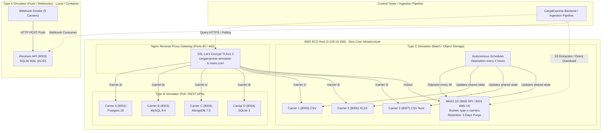

# CargaExpress: Architectural Decisions and Changelog for the 3 Simulators

This document consolidates the architecture, core design decisions, technical comparison matrix, and change history applied across the three carrier simulators in the **CargaExpress Control Tower** ecosystem:
- **Type A Simulator (Push / Webhooks - Requirement F3 / HU-17)**
- **Type B Simulator (Polling / REST APIs - Requirement F4)**
- **Type C Simulator (Batch / Object Storage - Requirement F5)**

---

## 1. Executive Summary & Comparative Matrix

The simulation subsystem enables the CargaExpress Control Tower and data ingestion pipelines to validate real-world integration scenarios across multiple logistics operators—covering diverse technological maturity levels, heterogeneous data formats, and controlled defects—**without dependency on live carrier accounts and incurring zero cloud infrastructure costs**.



### Comparative Matrix of the 3 Simulators

| Dimension | Type A (Push) | Type B (Poll) | Type C (Batch) |
| :--- | :--- | :--- | :--- |
| **Requirement** | **F3** (HU-17) | **F4** | **F5** |
| **Logistics Pattern** | **Active Push**: Carriers proactively dispatch events via HTTP POST (Webhooks). | **Pull / Polling**: Control Tower proactively queries tracking endpoints by waybill. | **Batch Deposition**: Carriers deposit periodic bulk files into Object Storage. |
| **Frequency** | Real-time continuous stream (configurable 1 to 100 req/s). | On-demand (HTTP GET with rate-limiting at 60 req/min). | **Every 4 hours** autonomously in the background. |
| **Simulated Carriers** | **5 carriers** (Alpha, Beta, Gamma, Delta, Epsilon). | **4 carriers** (Carrier A, B, C, D). | **3 carriers** (Carrier 1, Carrier 2, Carrier 3). |
| **Data Formats** | Flat JSON, nested JSON, wrapped metadata payloads, custom HTTP headers. | Normalized REST JSON per carrier catalog. | **Heterogeneous**: Carrier 1 in **CSV**, Carrier 2 in **Excel XLSX**, Carrier 3 in **CSV with numeric status codes**. |
| **Persistence Engine** | SQLite in WAL mode with idempotent ACID transactions. | Polyglot: **PostgreSQL 16**, **MySQL 8.4**, **MongoDB 7.0**, **SQLite 3**. | **Object Storage (MinIO / S3)** backed by persistent named volume (`minio_data`). |
| **Defect Injection** | Deliberate duplicate waybills, out-of-order temporal event delivery. | Variable network latencies, HTTP 429 rate-limiting responses. | Nonexistent waybills, mixed timestamp formats, broken headers, total summary footers, duplicates. |
| **Retention Policy** | Selective table purge or volume recreation. | Periodic event generator with sliding retention window. | **Automated Retention Purge**: Files older than `RETENTION_DAYS=3` are purged every 4 hours. |
| **Endpoints & Access** | Local port `9000` (Receiver API + Swagger). | Direct ports `8001-8004` and `https://.../carrier-{a,b,c,d}/`. | Direct ports `8005-8007`, `9000` (S3), `9001` (Web Console), and `https://.../carrier-{1,2,3}/`. |

---

## 2. Architectural Decision Records (ADRs)

### ADR-001: Hardened Multi-Stage Docker Builds on Alpine Linux
* **Context**: Simulators run on resource-constrained cloud compute (AWS EC2 Free Tier: 1 vCPU, 1 GB RAM). Heavy Debian/Ubuntu images consumed up to 800 MB per container, leading to out-of-memory (OOM) risks.
* **Decision**: Adopt a standardized multi-stage build pattern using `python:3.12-alpine` and Astral's `uv` package manager with ahead-of-time bytecode compilation (`UV_COMPILE_BYTECODE=1`).
* **Consequences & Benefits**:
  * Final Type C runtime image compressed transfer size reduced to only **54.5 MB**.
  * Build toolchains (`gcc`, `musl-dev`, `make`, caches) are excluded from the runtime layer.
  * Hardened non-root execution (`appuser`, UID 1000).

### ADR-002: Coexistence of Services on Single Free-Tier AWS EC2 Host
* **Context**: Provisioning managed AWS services (ECS, EKS, RDS, S3) would create recurring monthly cloud bills incompatible with the sprint budget constraint ($0.00).
* **Decision**: Consolidate all containerized services onto a single free-tier EC2 instance (`3.129.10.158`, Ohio `us-east-2`), provisioning a 2 GB swapfile and cleanly partitioning ports:
  * Ports 80 / 443: Nginx Gateway
  * Ports 8001-8004: Type B Carriers
  * Ports 8005-8007: Type C Carriers
  * Ports 9000 & 9001: MinIO S3 API & Web Console
* **Consequences & Benefits**:
  * System memory remains stable at ~385 MB free RAM + 1 GB free swap.
  * Total recurring infrastructure cost: **$0.00 USD**.

### ADR-003: Unified Nginx Gateway with Automated SSL Let's Encrypt & FreeDNS
* **Context**: Modern frontend clients and secure API pipelines reject insecure plain HTTP traffic and require valid trusted TLS certificates without incurring paid domain registration fees.
* **Decision**: Leverage a free dynamic DNS subdomain via FreeDNS (`cargaexpress-simulator-b.mooo.com`) pointing to the EC2 IP and configure Certbot with automated renewal for TLS v1.2 / TLS v1.3.
* **Consequences & Benefits**:
  * Unified, clean HTTPS routing for Type B carriers (`/carrier-a/` through `/carrier-d/`), Type C carriers (`/carrier-1/` through `/carrier-3/`), and MinIO (`/minio/`).
  * Zero browser security warnings; fully validated by global root CAs.

### ADR-004: MinIO S3-Compatible Object Storage (`pgsty/silo`) with Zero-Cost Retention
* **Context**: Requirement F5 dictates that carriers deposit CSV and Excel files into Object Storage. Public cloud buckets (AWS S3, Supabase Storage) impose egress charges or API rate limits. Furthermore, legacy `minio/minio` Docker Hub repositories were archived.
* **Decision**: Deploy `pgsty/silo:latest` (the active, community-maintained fork of MinIO) mounted on persistent volume `cargaexpress_type_c_minio_data`. Enforce strict retention cleanup deleting objects older than 3 days (`RETENTION_DAYS=3`) on every 4-hour cycle.
* **Consequences & Benefits**:
  * 100% standard S3 API compatibility (`boto3`, AWS CLI, SDKs).
  * Web Console UI on port 9001 for 1-click browser downloads.
  * Strictly bounded, predictable disk footprint.

### ADR-005: Hybrid Exposure: Dedicated Ports & Swagger Reverse Proxy Routing
* **Context**: Operators requested that Type C carriers provide dedicated per-carrier ports identical to Type B's operational model, while simultaneously integrating seamlessly behind the HTTPS reverse proxy.
* **Decision**: Implement a consolidated ASGI service running three concurrent FastAPI servers on ports 8005, 8006, and 8007 alongside the background 4-hour scheduler inside a single Python process. Explicitly configure `openapi_url` per carrier so Swagger UI functions cleanly behind subpath proxies.
* **Consequences & Benefits**:
  * Maximum memory efficiency: all 3 carrier APIs + scheduler consume ~40 MB of RAM total.
  * Downstream developers can query direct TCP ports (`:8005`) or secure public HTTPS URLs (`https://.../carrier-1/`).

---

## 3. Simulator Changelog

### Type A Simulator (`type_A_simulation_data`)
* **`feat(chaos)`**: Injected temporal disorder and duplicate delivery mechanisms for webhook streams.
* **`feat(receiver)`**: Designed ACID-compliant SQLite receiver API with WAL journal mode.
* **`feat(docker)`**: Hardened 3-stage Alpine Dockerfile with unprivileged user `app` (UID 10001).
* **`docs`**: Added multi-carrier ecosystem context to README.

### Type B Simulator (`type_B_simulation_data`)
* **`feat(carriers)`**: Implemented 4 independent carrier APIs with polyglot database persistence (Postgres, MySQL, Mongo, SQLite).
* **`feat(gateway)`**: Deployed Nginx reverse proxy with automated Let's Encrypt SSL certificates.
* **`feat(proxy-c)`**: Added reverse proxy locations for Type C carriers (`/carrier-1/`, `/carrier-2/`, `/carrier-3/`) and MinIO (`/minio/`).
* **`docs`**: Updated architecture documentation and endpoint matrices.

### Type C Simulator (`type_C_simulation_data`)
* **`feat(storage)`**: Developed `S3StorageManager` with partitioned timestamped uploads, presigned URLs, and automated retention cleanup.
* **`feat(scheduler)`**: Implemented autonomous 4-hour periodic scheduler (`INTERVAL_HOURS=4`) with anomaly injection and manifest generation.
* **`feat(api)`**: Built dedicated FastAPI carrier endpoints on ports 8005, 8006, and 8007 with direct file downloads (`/download`), JSON event feeds (`/events`), and Swagger docs (`/docs`).
* **`fix(docker)`**: Replaced archived MinIO image with `pgsty/silo:latest` and trimmed image size to 54.5 MB.
* **`fix(swagger)`**: Configured explicit `openapi_url` prefixing to eliminate OpenAPI parser errors behind Nginx reverse proxy.
* **`ci/cd`**: Created automated GitHub Actions workflow (`deploy.yml`) for pytest execution and SSH deployment to EC2 using GitHub Secrets.

---

## 4. Integration & Extraction Guide for Main Control Tower

Downstream backend services and data pipelines can extract simulated tracking data through the following methods:

### 1. Batch S3 Extraction via Python (`boto3`)
```python
import boto3

s3 = boto3.client(
    "s3",
    endpoint_url="http://3.129.10.158:9000",
    aws_access_key_id="cargaexpress_admin",
    aws_secret_access_key="cargaexpress_minio_secret_123",
)

# Download latest batch for Carrier 1 (CSV)
s3.download_file("type-c-carriers", "carrier_1/latest.csv", "carrier_1_latest.csv")

# Download latest batch for Carrier 2 (Excel XLSX)
s3.download_file("type-c-carriers", "carrier_2/latest.xlsx", "carrier_2_latest.xlsx")
```

### 2. Direct HTTPS Downloads
```bash
# Download CSV for Carrier 1
curl -s -O https://cargaexpress-simulator-b.mooo.com/carrier-1/download

# Fetch batch events in JSON format
curl -s https://cargaexpress-simulator-b.mooo.com/carrier-1/events
```

### 3. Query Type B Polling Endpoints via HTTPS
```bash
# Query waybill status on Carrier A (Postgres)
curl -s https://cargaexpress-simulator-b.mooo.com/carrier-a/shipments/TRK-A-000001
```

---
*Maintained by CargaExpress Architecture & Engineering Team. Version 1.0.0.*
