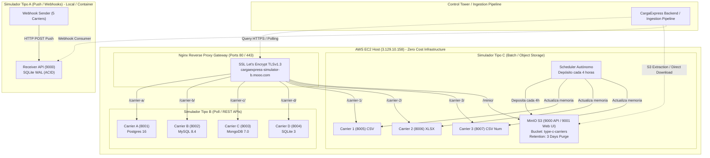

# CargaExpress: Decisiones Arquitectónicas y Registro de Cambios de los 3 Simuladores

Este documento consolida la arquitectura, las decisiones de diseño fundamentales, la comparativa técnica y el historial de cambios aplicados a los tres simuladores de transportadoras del ecosistema **CargaExpress Control Tower**:
- **Simulador Tipo A (Push / Webhooks - Requerimiento F3 / HU-17)**
- **Simulador Tipo B (Polling / REST APIs - Requerimiento F4)**
- **Simulador Tipo C (Batch / Object Storage - Requerimiento F5)**

---

## 1. Resumen Ejecutivo y Matriz Comparativa

El objetivo del subsistema de simulación es permitir que la torre de control y las tuberías de ingesta de CargaExpress puedan probar escenarios reales de integración con múltiples operadores logísticos, con diferentes niveles de madurez tecnológica, formatos heterogéneos y fallas controladas, **sin depender de transportadoras reales ni incurrir en costos en la nube**.



### Matriz Comparativa de los 3 Simuladores

| Dimensión | Tipo A (Push) | Tipo B (Poll) | Tipo C (Batch) |
| :--- | :--- | :--- | :--- |
| **Requerimiento** | **F3** (HU-17) | **F4** | **F5** |
| **Patrón Logístico** | **Push Activo**: Las transportadoras envían eventos vía HTTP POST (Webhooks). | **Pull / Polling**: La Torre de Control consulta activamente por número de guía. | **Batch Deposition**: Las transportadoras depositan archivos masivos periódicos. |
| **Frecuencia** | Tiempo real / flujo continuo (configurable de 1 a 100 req/s). | Bajo demanda (HTTP GET con Rate Limiting de 60 req/min). | **Cada 4 horas** automáticamente en segundo plano. |
| **N° Operadores** | **5 transportadoras** (Alpha, Beta, Gamma, Delta, Epsilon). | **4 transportadoras** (Carrier A, B, C, D). | **3 transportadoras** (Carrier 1, Carrier 2, Carrier 3). |
| **Formatos de Datos** | JSON plano, JSON anidado, formato con wrapper metadata, payloads con headers personalizados. | JSON REST normalizado por cada operador. | **Heterogéneo**: Carrier 1 en **CSV**, Carrier 2 en **Excel XLSX**, Carrier 3 en **CSV con códigos numéricos**. |
| **Persistencia** | SQLite en modo WAL con transacciones ACID idempotentes. | Políglota: **PostgreSQL 16**, **MySQL 8.4**, **MongoDB 7.0**, **SQLite 3**. | **Object Storage (MinIO / S3)** con volumen persistente (`minio_data`). |
| **Inyección de Defectos** | Duplicados deliberados, entrega fuera de orden temporal (reordenamiento caótico). | Latencias variables, rate-limiting HTTP 429, estados de error. | Guías inexistentes, timestamps mixtos, cabeceras rotas, filas de totales, duplicados. |
| **Política de Purga** | Limpieza selectiva o reinicio de volumen SQLite. | Generador periódico con ventana deslizante de retención. | **Purga automática de retención**: Se borran objetos mayores a `RETENTION_DAYS=3` cada 4h. |
| **Endpoints y Acceso** | Puerto local `9000` (Receiver API + Swagger). | Puertos `8001-8004` (directos) y `https://.../carrier-{a,b,c,d}/`. | Puertos `8005-8007` (directos), `9000` (S3), `9001` (Consola Web) y `https://.../carrier-{1,2,3}/`. |

---

## 2. Registro de Decisiones Arquitectónicas (ADRs)

### ADR-001: Contenerización Multi-Stage Hardened con Alpine Linux
* **Contexto**: Los simuladores deben ejecutarse en instancias con recursos ajustados (AWS EC2 Free Tier: 1 CPU, 1 GB RAM). El uso de imágenes pesadas basadas en Ubuntu/Debian consumía hasta 800 MB por contenedor, amenazando con provocar condiciones de Out-Of-Memory (OOM).
* **Decisión**: Se implementó una arquitectura de construcción Docker en múltiples etapas (*multi-stage builds*) utilizando `python:3.12-alpine` y `uv` de Astral como gestor de paquetes de alta velocidad.
* **Impacto y Resultados**:
  * La imagen del Simulador Tipo C se redujo a sólo **54.5 MB** de tamaño de transferencia.
  * Todas las herramientas de compilación (`gcc`, `musl-dev`, `make`, caches) quedan fuera de la imagen final.
  * Ejecución segura bajo usuario no privilegiado (`appuser`, UID 1000) sin permisos de root.

### ADR-002: Infraestructura Compartida Zero-Cost ($0.00) en AWS EC2
* **Contexto**: Desplegar los tres simuladores en servicios administrados independientes (AWS ECS, EKS, RDS o S3) generaría costos recurrentes mensuales no viables para el desarrollo del sprint.
* **Decisión**: Consolidar los servicios en una única instancia EC2 (`t2.micro` / `t3.micro` en Ohio `us-east-2`, IP `3.129.10.158`) configurando una partición Swap de 2 GB y asignando puertos de forma ordenada y no colisionante:
  * Puertos 80 / 443: Gateway Nginx
  * Puertos 8001 a 8004: Transportadoras Tipo B
  * Puertos 8005 a 8007: Transportadoras Tipo C
  * Puertos 9000 y 9001: MinIO S3 API y Consola Web
* **Impacto y Resultados**:
  * Uso de memoria disponible estable en ~385 MB libres + 1 GB swap disponible.
  * Costo total de infraestructura: **$0.00 USD**.

### ADR-003: Reverse Proxy Nginx con SSL Let's Encrypt y FreeDNS
* **Contexto**: El consumo de APIs desde aplicaciones cliente modernas y navegadores bloquea peticiones HTTP inseguras y requiere nombres de dominio válidos sin incurrir en compra de dominios pagados.
* **Decisión**: Integrar un subdominio gratuito a través de FreeDNS (`cargaexpress-simulator-b.mooo.com`) asociado a la IP de la EC2, configurando Certbot para renovación automática de certificados SSL/TLS v1.2 y v1.3.
* **Impacto y Resultados**:
  * Enrutamiento unificado bajo HTTPS seguro para las transportadoras del Tipo B (`/carrier-a/` a `/carrier-d/`) y del Tipo C (`/carrier-1/` a `/carrier-3/`), además de la consola MinIO (`/minio/`).
  * Sin advertencias de seguridad en navegadores ni problemas de certificados autofirmados.

### ADR-004: Almacenamiento de Objetos MinIO (`pgsty/silo`) con Retención de Costo Cero
* **Contexto**: El requerimiento F5 exige que las transportadoras depositen archivos CSV y Excel en un *Object Storage*. Supabase Storage o AWS S3 directo presentan límites de cuota, costos por egress o dependencias de red externas. Además, Docker Hub archivó las imágenes comunitarias heredadas de `minio/minio`.
* **Decisión**: Se adoptó la imagen `pgsty/silo:latest` (fork mantenido y activo de MinIO), conectada a un volumen Docker persistente (`minio_data`). Se programó una rutina de retención estricta que borra automáticamente archivos de más de 3 días (`RETENTION_DAYS=3`) en cada ciclo de 4 horas.
* **Impacto y Resultados**:
  * Compatibilidad 100% con la API S3 estándar (consumible con `boto3`, AWS CLI y cualquier cliente S3).
  * Consola visual web en puerto 9001 para que cualquier miembro del equipo descargue archivos en 1 clic.
  * Consumo de disco estrictamente acotado y predecible.

### ADR-005: Exposición Híbrida de Puertos Dedicados y Swagger OpenAPI
* **Contexto**: El usuario solicitó expresamente que el Simulador Tipo C operara con la misma lógica del Tipo B, donde cada transportadora es accesible mediante un puerto dedicado, pero manteniendo la compatibilidad con el Gateway HTTPS.
* **Decisión**: Se implementó un servidor ASGI unificado que levanta tres instancias concurrentes de FastAPI en los puertos 8005, 8006 y 8007, ejecutando simultáneamente la tarea en segundo plano del generador de 4 horas en un único contenedor. Cada instancia expone `/docs` con la especificación `openapi_url` prefijada para operar limpiamente detrás del reverse proxy.
* **Impacto y Resultados**:
  * Rendimiento extremo: una sola instancia de Python consume sólo ~40 MB de RAM para las 3 transportadoras + scheduler.
  * Los consumidores pueden probar directamente por puerto TCP (`:8005`) o a través de la URL segura (`https://.../carrier-1/`).

---

## 3. Registro Histórico de Cambios (Changelog de los Simuladores)

### Simulador Tipo A (`type_A_simulation_data`)
* **`feat(chaos)`**: Implementado motor de inyección de desorden para simular llegada de eventos duplicados y fuera de orden cronológico.
* **`feat(receiver)`**: Diseñada API receptora con almacenamiento SQLite transaccional ACID en modo WAL (`journal_mode=WAL`) para alta concurrencia.
* **`feat(docker)`**: Optimizado Dockerfile multi-stage de 3 etapas (`builder`, `test`, `runtime`) basado en Alpine Linux con usuario no root `app` (UID 10001).
* **`docs`**: Incorporada documentación de integración en el ecosistema global de CargaExpress.

### Simulador Tipo B (`type_B_simulation_data`)
* **`feat(carriers)`**: Implementadas 4 APIs REST independientes con bases de datos heterogéneas (PostgreSQL, MySQL, MongoDB, SQLite).
* **`feat(gateway)`**: Desplegado contenedor Nginx con redirección HTTP a HTTPS y certificados SSL de Let's Encrypt sobre `cargaexpress-simulator-b.mooo.com`.
* **`feat(proxy-c)`**: Agregadas directivas de proxy reverso para enrutar tráfico del Simulador Tipo C (`/carrier-1/`, `/carrier-2/`, `/carrier-3/`) y MinIO (`/minio/`).
* **`docs`**: Actualizada tabla de arquitectura con los nuevos endpoints HTTPS y coexistencia en EC2.

### Simulador Tipo C (`type_C_simulation_data`)
* **`feat(storage)`**: Desarrollado `S3StorageManager` con subida a particiones por fecha, generación de URLs prefirmadas y purga automática por retención (`cleanup_retention`).
* **`feat(scheduler)`**: Creado planificador autónomo que genera archivos cada 4 horas (`INTERVAL_HOURS=4`) para las 3 transportadoras (CSV, XLSX, CSV numérico) con inyección de anomalías y subida de manifiestos.
* **`feat(api)`**: Implementado servidor FastAPI con endpoints dedicados en los puertos 8005, 8006 y 8007 con descargas directas (`/download`), eventos en JSON (`/events`), healthchecks y Swagger UI (`/docs`).
* **`fix(docker)`**: Sustituida imagen deprecada de MinIO por `pgsty/silo:latest` y optimizado Dockerfile Alpine a 54.5 MB.
* **`fix(swagger)`**: Corregida ruta de OpenAPI explícita (`openapi_url`) para eliminar el error de parsing en Swagger UI tras pasar por Nginx.
* **`ci/cd`**: Configurado pipeline de GitHub Actions (`deploy.yml`) para pruebas automáticas con pytest y despliegue continuo vía SSH en AWS EC2 mediante GitHub Secrets.

---

## 4. Guía de Consumo e Integración para el Proyecto Principal

Cualquier servicio de la Torre de Control o pipeline de datos puede consumir los datos simulados de acuerdo a sus necesidades:

### 1. Ingesta Batch de Tipo C vía Python (`boto3`)
```python
import boto3

s3 = boto3.client(
    "s3",
    endpoint_url="http://3.129.10.158:9000",
    aws_access_key_id="cargaexpress_admin",
    aws_secret_access_key="cargaexpress_minio_secret_123",
)

# Descargar el lote más reciente de la Transportadora 1 (CSV)
s3.download_file("type-c-carriers", "carrier_1/latest.csv", "carrier_1_latest.csv")

# Descargar el lote de la Transportadora 2 (Excel XLSX)
s3.download_file("type-c-carriers", "carrier_2/latest.xlsx", "carrier_2_latest.xlsx")
```

### 2. Descarga Directa vía HTTPS
```bash
# Descargar CSV de Transportadora 1
curl -s -O https://cargaexpress-simulator-b.mooo.com/carrier-1/download

# Obtener eventos en formato JSON
curl -s https://cargaexpress-simulator-b.mooo.com/carrier-1/events
```

### 3. Consulta de Guía en Transportadoras Tipo B vía HTTPS
```bash
# Consultar guía en Carrier A (Postgres)
curl -s https://cargaexpress-simulator-b.mooo.com/carrier-a/shipments/TRK-A-000001
```

---
*Documento generado y mantenido por el equipo de arquitectura de CargaExpress. Versión 1.0.0.*
